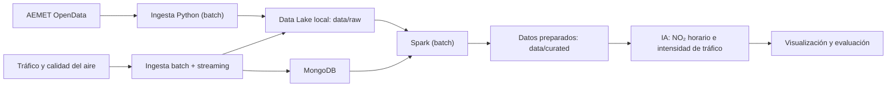

# Proyecto 4 · Big Data urbano (Valencia)

> Proyecto del módulo Big Data aplicado. Integración de datos urbanos abiertos de Valencia para su procesamiento y posterior análisis predictivo.

## Descripción y objetivo

Pipeline completo de ingeniería de datos (batch + streaming) sobre datos abiertos de tráfico, calidad del aire y meteorología de Valencia. Los datos se cruzan con Spark y el proyecto termina con dos modelos predictivos: uno principal de NO₂ horario y uno secundario de intensidad de tráfico.

Este es el alcance objetivo del proyecto. **Actualmente está implementada una primera ingesta batch de AEMET**, que consulta su API y guarda la respuesta en un archivo JSON local. La integración de tráfico y calidad del aire, el streaming, el almacenamiento en MongoDB, las transformaciones con Spark y los modelos predictivos siguen pendientes.

## Arquitectura



*Diagrama del alcance previsto. Solo está implementado el recorrido AEMET → ingesta Python → JSON local en `data/raw/`. Los textos de los nodos se escriben entre comillas para que Mermaid interprete correctamente los paréntesis y caracteres especiales.*

## Fuentes de datos

| Fuente | URL / origen | Formato | Frecuencia de actualización | Licencia / condiciones de uso | Última ingesta |
| --- | --- | --- | --- | --- | --- |
| AEMET OpenData | [API de AEMET](https://opendata.aemet.es/), estación `8416Y` en el script actual | JSON obtenido mediante API REST | Consulta manual de valores climatológicos diarios | Consultar las condiciones de AEMET y citar la procedencia de la información | Existe una descarga local fechada el `2026-10-14`; no acredita la ejecución del endpoint actual |
| Tráfico de Valencia | Fuente concreta pendiente de seleccionar en el [portal de datos abiertos de Valencia](https://valencia.opendatasoft.com/) | Por confirmar al seleccionar el conjunto | Por confirmar | Revisar la licencia del conjunto elegido | Pendiente |
| Calidad del aire | Fuente y estaciones pendientes de seleccionar | Por confirmar | Por confirmar; el objetivo analítico es horario | Revisar las condiciones de la fuente elegida | Pendiente |

**Alcance de la muestra local:** el JSON fechado el `2026-10-14` contiene una predicción municipal de Valencia. El script actual consulta valores climatológicos diarios de una estación; por tanto, la muestra no corresponde al endpoint actual. Los datos diarios tampoco bastan por sí solos para entrenar un modelo horario de NO₂: habrá que seleccionar y alinear fuentes con la resolución temporal adecuada.

## Estructura del repositorio

| Carpeta / archivo | Contenido y estado |
| --- | --- |
| `ingesta/ingesta_api.py` | Consulta AEMET, valida su respuesta, descarga los datos y los guarda como JSON |
| `etl/` | Carpeta local vacía, reservada para las transformaciones y cruces con Spark |
| `dashboard/` | Carpeta local vacía, reservada para visualizaciones y resultados |
| `data/raw/` | Descargas originales locales; `.gitkeep` versionado y JSON excluidos de Git |
| `data/staged/` | Zona de datos intermedios, actualmente con `.gitkeep` |
| `data/curated/` | Zona de datos preparados para análisis, actualmente con `.gitkeep` |
| `.env.example` | Plantilla con `API_KEY=your_api_key_here`, sin una clave real |
| `.gitignore` | Exclusiones de datos, credenciales, entornos Python, notebooks y volúmenes locales |
| `.venv/` | Entorno Python local, no versionado |
| `README.md` | Documentación de la arquitectura, ejecución y seguimiento |

**Nota:** Git no versiona carpetas vacías. `etl/` y `dashboard/` no aparecerán en un clon hasta que contengan archivos o `.gitkeep`. El proyecto no incluye todavía un archivo de dependencias ni un `docker-compose.yml`.

## Cómo desplegar el entorno

### Requisitos

- Python 3 con los módulos `venv` y `pip` disponibles.
- Conexión a Internet y una clave válida de AEMET OpenData.
- Ejecutar los comandos desde la raíz de este proyecto.

### Preparar Python y la configuración

En Linux o macOS, si no se dispone de un entorno virtual:

```bash
python3 -m venv .venv
source .venv/bin/activate
python -m pip install requests python-dotenv
```

Estas son las dependencias externas utilizadas por el script actual. Sus versiones todavía no están fijadas en un archivo de dependencias.

Si no existe `.env`, crear una copia de la plantilla:

```bash
cp -n .env.example .env
```

Editar `.env` y sustituir el valor de ejemplo por la clave personal de AEMET:

```dotenv
API_KEY=tu_clave_personal_de_aemet
```

La clave se carga desde `.env` mediante `python-dotenv`; no debe escribirse en el script, publicarse en Git ni aparecer en capturas.

### Ejecutar la ingesta

Antes de ejecutar, revisar `API_URL` en `ingesta/ingesta_api.py`: actualmente consulta la estación `8416Y` entre `2026-10-15` y `2026-10-29`. El intervalo está fijado en el código y debe ajustarse a fechas ya disponibles en AEMET; no se actualiza automáticamente.

```bash
python ingesta/ingesta_api.py
```

El script realiza dos peticiones: primero solicita a AEMET la URL temporal de los datos y después descarga su contenido. Si la operación termina correctamente, muestra `Ingesta completada correctamente.` y crea:

```text
data/raw/dataset_AAAA-MM-DD.json
```

La fecha del nombre corresponde al día de ejecución, no al período meteorológico consultado. **Una nueva ejecución el mismo día sobrescribe ese archivo.** Conviene comprobar que el JSON contiene los datos esperados: el script valida la respuesta inicial, pero todavía no comprueba el esquema del conjunto descargado.

No es necesario desplegar MongoDB o Spark para ejecutar esta primera ingesta; esas etapas todavía no están implementadas.

## Bitácora de prácticas

### Bloque 0 · Entorno

- **Objetivo:** preparar el repositorio, el entorno Python y una configuración local sin publicar credenciales.
- **Pasos realizados:** incorporación de `.env.example`, `.gitignore`, script de ingesta y directorios de datos con `.gitkeep`.
- **Problemas encontrados y solución:** los datos descargados y el entorno virtual no deben versionarse; el `.gitignore` actual los excluye y conserva los `.gitkeep` de las zonas de datos.
- **Resultado:** estructura preparada para ejecutar la ingesta con una clave de AEMET local.

### Bloque 1 · Ingesta batch de AEMET

- **Objetivo:** descargar información meteorológica mediante API y conservar el resultado original en JSON.
- **Pasos realizados:** carga de `API_KEY` desde `.env`, petición al endpoint, validación del estado y de la URL de descarga, segunda petición y guardado en UTF-8 dentro de `data/raw/`.
- **Problemas encontrados y solución:** el script contempla la ausencia de clave, errores HTTP, respuestas iniciales inesperadas y ausencia de URL de datos, mostrando un mensaje de error. La descarga necesita la segunda petición a la URL facilitada por AEMET.
- **Resultado:** script de ingesta disponible y muestra JSON local de una consulta anterior. Está pendiente verificar una descarga del endpoint climatológico actual con un intervalo válido.

### Siguientes bloques · Integración, Spark e IA

- **Objetivo:** incorporar tráfico y calidad del aire, preparar los datos y entrenar los modelos de NO₂ e intensidad de tráfico.
- **Pasos realizados:** pendiente de seleccionar las fuentes restantes y definir claves de unión espaciales y temporales.
- **Problemas encontrados y solución:** pendiente de resolver la diferencia entre la resolución diaria de la consulta actual y el objetivo horario del modelo principal.
- **Resultado:** streaming, MongoDB, ETL, modelos y visualización pendientes de implementación y evaluación.

## Decisiones técnicas

| Decisión | Alternativa considerada | Motivo |
| --- | --- | --- |
| API REST de AEMET con `requests` | Descarga manual de ficheros | Permite repetir la consulta y controlar errores desde el script |
| Clave en `.env` y plantilla `.env.example` | Clave escrita en el código | Separa la configuración privada del código versionado |
| Conservar el JSON original en `data/raw/` | Transformar los datos sin conservar el origen | Facilita revisar y reprocesar la respuesta original |
| Comenzar por una ingesta batch | Implementar batch y streaming simultáneamente | Permite validar una primera fuente antes de ampliar el flujo |
| Spark y zonas `staged` / `curated` como diseño objetivo | Mezclar datos originales y transformados | Separa las etapas de preparación; su implementación está pendiente |

## Incidencias resueltas

| Incidencia | Solución / estado |
| --- | --- |
| Faltaba documentar la estructura del repositorio | Se añade la tabla de carpetas y archivos con su estado actual |
| El nodo `Spark (batch)` podía provocar errores de Mermaid | Se entrecomillan los textos de los nodos del diagrama |
| La consulta a AEMET requiere una descarga adicional | El script obtiene la URL `datos` y realiza una segunda petición para recuperar el JSON |
| Era necesario separar las credenciales del código | El script lee `API_KEY` de `.env` y el repositorio ofrece una plantilla sin clave real |

**Pendientes:** parametrizar las fechas de consulta, validar el esquema descargado, evitar sobrescrituras si se necesitan varias capturas diarias y fijar versiones de dependencias. La muestra local también presenta caracteres de Valencia mal decodificados; deberá revisarse la codificación antes de utilizarla en análisis. Estas tareas no se dan por resueltas con la actualización del README.
